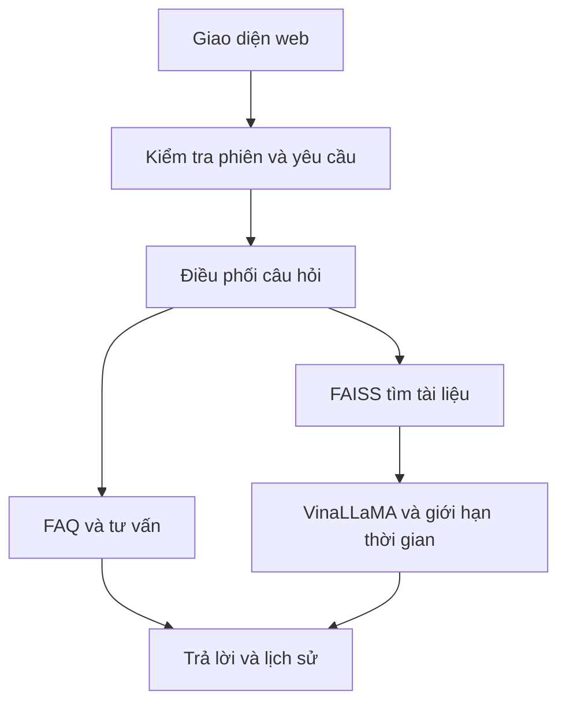

# Đặc tả và thiết kế PhoneGPT

## Mục tiêu và phạm vi

Hỗ trợ người dùng tra cứu thông số, so sánh các phiên bản điện thoại và nhận gợi ý theo ngân sách, nhu cầu. Đầu vào là ngôn ngữ tự nhiên tiếng Việt. Dữ liệu nền là các cặp hỏi–đáp trong sheet training của data1.xlsx. Sheet test phục vụ đánh giá hồi quy.

## Yêu cầu chức năng

| Mã | Yêu cầu | Điều kiện chấp nhận |
| --- | --- | --- |
| CN01 | Đăng ký và đăng nhập | Tài khoản duy nhất, mật khẩu được băm, từ chối mật khẩu sai |
| CN02 | Tra cứu sản phẩm | Trả lời gắn đúng phiên bản máy và các dòng dữ liệu đã dùng |
| CN03 | So sánh | Nêu thông tin có trong dữ liệu, chỉ rõ thuộc tính còn thiếu |
| CN04 | Tư vấn | Áp dụng ngân sách, hãng và nhu cầu theo dữ liệu hiện có |
| CN05 | Hội thoại nhiều lượt | Nhận tối đa 12 câu lịch sử hợp lệ, giao diện gửi 8 câu gần nhất |
| CN06 | Quản lý lịch sử | Mỗi tài khoản chỉ đọc và xóa bản ghi thuộc mình |
| CN07 | Nguồn tham khảo | Có thể mở nguồn HTTPS hoặc thấy trạng thái thiếu nguồn |
| CN08 | Xử lý lỗi lưu | Câu trả lời có trạng thái history_saved để thông báo lỗi lưu |

## Kiến trúc xử lý

FAQ và luật tư vấn được ưu tiên. Với câu cần truy xuất, hệ thống lọc tài liệu theo mẫu máy và thuộc tính. VinaLLaMA có thể diễn đạt từ tài liệu đã chọn. Khi hết thời gian, hệ thống trả thông tin nền có sẵn hoặc thông báo cần làm rõ. Một worker giới hạn việc dùng model đồng thời.

## Mô hình dữ liệu

`users` có id, username duy nhất, password chứa băm và created_at. `chat_history` có id, username, question, answer, sources và created_at. Chỉ mục (username, id) hỗ trợ đọc lịch sử. `active_sessions` chứa băm mã phiên, username và thời điểm hết hạn. `request_limits` chứa khóa băm, cửa sổ thời gian và bộ đếm.

MongoDB là cấu hình tùy chọn. Khi đang dùng MongoDB, lỗi đọc hoặc ghi lịch sử được báo cho người dùng. Khởi động không kết nối được MongoDB vẫn chọn SQLite theo hành vi hiện có, vì vậy cần kiểm tra đúng chế độ lưu khi vận hành.

## Mối đe dọa và kiểm soát

| Mối đe dọa | Biện pháp và bằng chứng |
| --- | --- |
| SQL injection | Câu lệnh tham số hóa, kiểm thử tên đăng nhập có chuỗi SQL |
| Đọc/xóa lịch sử tài khoản khác | Điều kiện username đi cùng id, test_history_delete.py |
| CSRF | Token phiên và kiểm tra Origin, test_security_controls.py |
| Đánh cắp hoặc phát lại phiên đã đăng xuất | HttpOnly, SameSite Strict, thu hồi mã phiên phía server |
| Dò mật khẩu hoặc gửi dồn yêu cầu | Bộ đếm SQLite, 20 lần/5 phút cho từng endpoint xác thực và IP |
| Payload quá lớn | Body 32 KiB, câu hỏi 2.000 ký tự, giới hạn lịch sử |
| Nội dung HTML trong câu hỏi/câu trả lời | Hiển thị bằng textContent/innerText |
| Rò rỉ chi tiết khi database lỗi | Thông báo chung, ghi nhãn lỗi cố định trong nhánh lịch sử |
| Thực thi pickle | Web dựng metadata từ Excel, đọc chỉ mục FAISS trực tiếp |

Giới hạn còn lại gồm CSP cho phép inline script/style, chưa có MFA và khôi phục mật khẩu, chưa kiểm thử triển khai HTTPS. Cơ chế lọc tài liệu và prompt chưa bảo đảm chặn mọi prompt injection hoặc mọi phát biểu sai của model.

## Tham khảo

- OWASP CSRF Prevention Cheat Sheet — https://cheatsheetseries.owasp.org/cheatsheets/Cross-Site_Request_Forgery_Prevention_Cheat_Sheet.html
- OWASP Session Management Cheat Sheet — https://cheatsheetseries.owasp.org/cheatsheets/Session_Management_Cheat_Sheet.html
